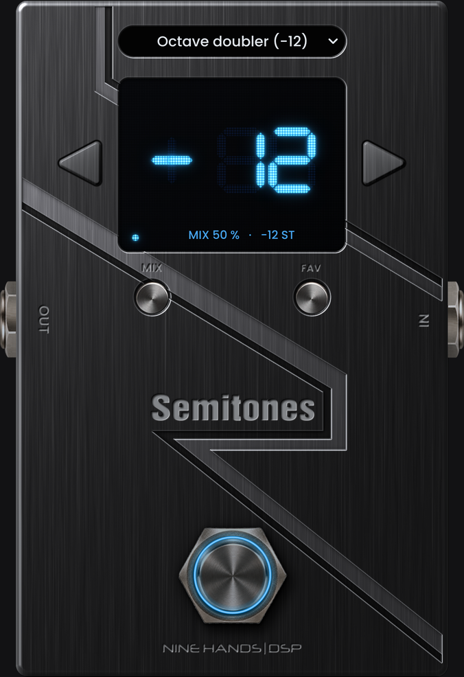

# Semitones (NINE HANDS | DSP)

Réplique VST3 de la pédale **Solar Guitars CHUG Capo** : transposition de -12 à +12 demi-tons à très faible latence (« capodastre numérique »), mode **MIX** (signal transposé + signal direct, 0 à 100 %) et mémoire **FAV**. Format pédale simple, Windows et macOS. Design v2 : façade en aluminium brossé noir avec bandes usinées, afficheur bleu à matrice de points, textes vectoriels creusés dans le métal, anneau lumineux bleu (style Octopus) autour du footswitch, lumière en haut à gauche à 45°.



- Notice (français) : `docs/Semitones_Notice_FR_v2.0.0.pdf`
- Builds prêts à installer : onglet **Actions** > dernier run > artefacts `Semitones-VST3-Windows` / `Semitones-VST3-macOS`

<p align="center">
  <a href="https://github.com/Nine-Hands-Dsp/Semitones/releases/latest/download/Semitones-VST3-Windows.zip"></a>
  <a href="https://github.com/Nine-Hands-Dsp/Semitones/releases/latest/download/Semitones-VST3-macOS.zip"></a>
  <br>
  <a href="https://github.com/Nine-Hands-Dsp/Semitones/releases/latest/download/Semitones-Notice.pdf"></a>
  <br>
  <a href="https://github.com/Nine-Hands-Dsp/Semitones/releases/latest"></a>
</p>

## Fonctionnement (comme la pédale)

| Commande | Clic | Maintien |
|---|---|---|
| ◀ / ▶ | -1 / +1 demi-ton (répétition si maintenu) | — |
| MIX | mode MIX marche / arrêt | 0,6 s : réglage du mix aux flèches (LED et point MIX clignotent) |
| FAV | rappel / sortie de la mémoire FAV | 0,9 s : mémorise le son actuel comme FAV |
| Footswitch | effet / bypass (bascule à l'appui) | — |

Anneau bleu autour du footswitch (style Octopus, intensité du halo réglable par clic droit > Glow : 25 / 50 / 75 / 100 %) : allumé = effet actif, éteint = bypass, clignotant = réglage du mix. Point bleu dans l'afficheur quand le mode MIX est actif ; ligne d'état dans l'afficheur (MIX / DRY OFF, transposition, FAV, BYPASS). Menus clic droit au design d'Octopus, ouverts à l'endroit du clic. Clic droit sur une commande : MIDI learn (switchs à accrochage ou momentanés, pédales d'expression lissées, CC 14 bits, course apprise). Pendant l'attente la ligne d'état affiche « MIDI LEARN: <commande> », puis 2 s « <commande> = CC n » ; « Clear MIDI » retire l'assignation. Clic droit sur le fond : sous-menu MIDI (Learn de toutes les commandes, Reset MIDI to defaults) et *Plugin size* (60 % = minimum, 75 %, 100 %, « (default) » sur la taille par défaut choisie) avec *Default size (new windows)* : taille à laquelle s'ouvrent les nouvelles fenêtres du plugin (réglage commun à toutes les instances), appliquée aussi tout de suite à la fenêtre courante.

## Moteur audio

`PitchShifter.h` (indépendant de JUCE) : transposition temporelle à raccords synchronisés sur la période (corrélation normalisée, recherche grossière décimée puis fine avec interpolation), suivi de hauteur YIN jusqu'à ~31 Hz (7/8 cordes, basse), retour sur l'audio le plus récent à chaque attaque, fondus dépendant de la corrélation, adaptation automatique aux accords, anti-repliement pour les transpositions vers le haut. Retard mesuré : ~2 ms (aigus) à 6-10 ms (cordes graves), aucune latence déclarée à l'hôte. Tests : `tools/dsp_test.cpp`.

## Anti-gel v2

JUCE 8.0.15, `setOpaque`, rendu logiciel forcé sous Windows (réappliqué si le peer change), aucun calcul lourd dans `paint()`, caches reconstruits par le timer seulement, chien de garde de redessin (1,5 s), timer 30 Hz avec redessin des seules zones modifiées, jamais de `setSize` dans `resized()`, aucun appel à l'hôte depuis le thread audio (file vidée par un timer 60 Hz), paramètres lus par pointeurs atomiques.

## Construire

```
cmake -B build && cmake --build build --config Release --target Semitones_VST3
```

Visuel : `python3 -I tools/make_art_v3.py` (génère `assets/background.png`, les sprites et `Layout.h` depuis la maquette `design/Semitones_Design_v002.svg`, la texture `design/v3src/brushed_black_4096.png` et le masque `design/Semitones_Design_Mask_v002.svg`). Notice : `python3 tools/manual_v2.py <dossier des captures> docs/Semitones_Notice_FR_v<version>.pdf`. Outil Linux de captures + tests audio : `-DSEMITONES_BUILD_RENDER=ON`, cible `SemitonesRender`.

## Historique

- **1.4.7** — le menu des presets s'ouvre toujours au même endroit, juste sous la case, quel que soit le preset choisi (il ne sort plus de l'écran avec les presets du bas de la liste).
- **1.4.6** — menu des presets fiable à la souris : le preset choisi est appliqué immédiatement à la fermeture du menu (la notification différée de JUCE pouvait être écrasée par le rafraîchissement de l'affichage) ; la case n'est plus resynchronisée tant que le menu est ouvert.
- **1.4.5** — retour au visuel de la 1.4.1 (éclairage d'origine, vis d'origine) ; seul changement : un point bleu rond au-dessus de MIX dans l'afficheur à la place du trait. Les essais 1.4.2 à 1.4.4 sont abandonnés.
- **1.4.1** — trait bleu au-dessus de MIX dans l'afficheur quand le mode MIX est actif (clignote pendant le réglage du mix) ; ligne d'état agrandie.
- **1.4.0** — pédale agrandie, fenêtre 391 x 493 (taille par défaut et minimum) ; menu des presets placé sur la pédale au-dessus de l'écran ; textes plus grands (menu, liste, ligne d'état) et noms de presets raccourcis ; halo du footswitch légèrement adouci.
- **1.3.1** — menu des presets fiabilisé : liste groupée (titres non sélectionnables), case jamais éditable ni prise au clavier ou à la molette, presets de l'hôte (Reaper) appliqués de façon sûre quel que soit le thread ; nom gravé réduit.
- **1.3.0** — nouveau design (acier brossé sombre sur béton, afficheur à matrice de points), nom « Semitones » gravé, indicateurs MIX / FAV retirés de l'afficheur.
- **1.2.0** — fenêtre et pédale réduites à la taille des pédales simples NINE HANDS | DSP (380 x 479 par défaut et minimum) ; anneau bleu avec lumière tournante à longue traînée.
- **1.1.0** — nouveau design acier brossé ; la LED est remplacée par un anneau lumineux bleu autour du footswitch ; build macOS sur `macos-15`.
- **1.0.0** — première version : visuel identique à la CHUG Capo + logo NINE HANDS | DSP noir, moteur faible latence, MIX, FAV, presets d'usine, MIDI learn, anti-gel v2.

- v1.4.8 : menu de taille de fenêtre : « 60 % (default) », 75 %, 100 % (plus de taille en pixels)
- v1.5.0 : MIDI Learn au clic droit sur chaque commande (Clear MIDI, assignations sauvegardées avec le projet)

- v1.5.1 : menu de taille aligné sur les autres pédales : 60 % (default), 75 %, 100 %
- v1.6.0 : clic droit > Plugin size > Default size (new windows) : taille par défaut des nouvelles fenêtres au choix, comme dans Octopus
